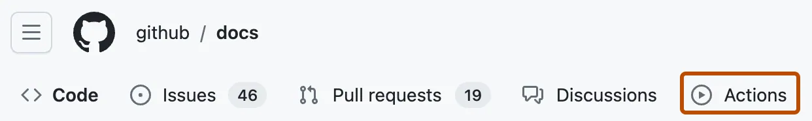
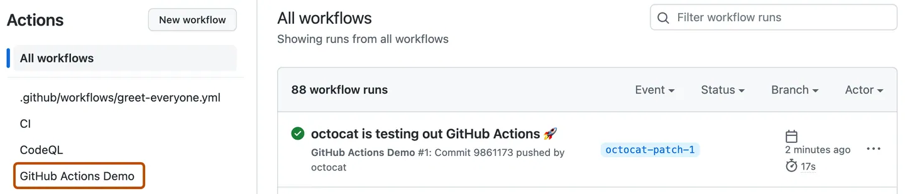
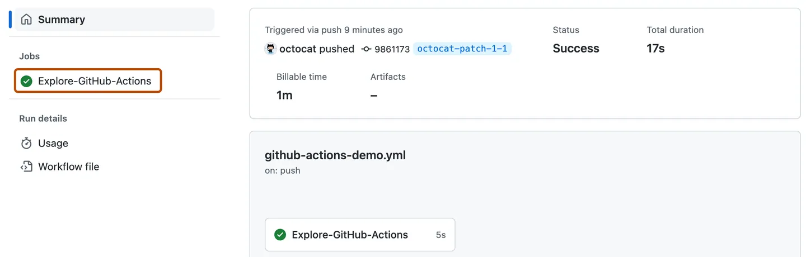
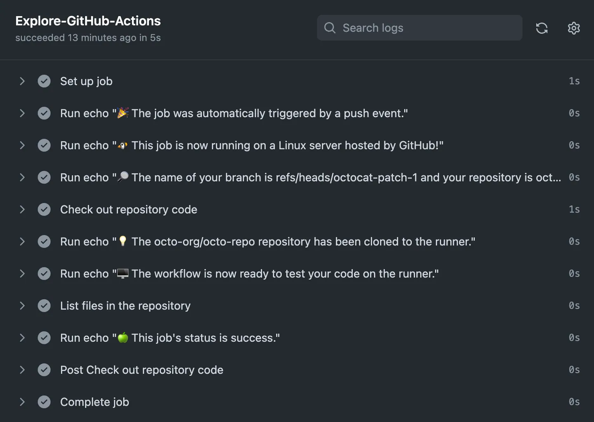

# GitHub Actions documentation <!-- omit in toc -->

Automate, customize, and execute your software development workflows right in your repository with GitHub Actions. You can discover, create, and share actions to perform any job you'd like, including CI/CD, and combine actions in a completely customized workflow.

# 1. Quickstart for GitHub Actions

## 1.1. Introduction

GitHub Actions is a continuous integration and continuous delivery (CI/CD) platform that allows you to automate your build, test, and deployment pipeline.

This quickstart guide shows you how to use the user interface of GitHub to add a workflow that demonstrates some of the essential features of GitHub Actions.

## 1.2. Using workflow templates

GitHub provides preconfigured workflow templates that you can use as-is or customize to create your own workflow. GitHub analyzes your code and shows you workflow templates that might be useful for your repository. For example, if your repository contains `Node.js` code, you'll see suggestions for `Node.js` projects.

These workflow templates offers a range of configurations such as:

- CI: [Continuous Integration workflows](https://github.com/actions/starter-workflows/tree/main/ci)
- Deployments: [Deployment workflows](https://github.com/actions/starter-workflows/tree/main/deployments)
- Automation: [Automating workflows](https://github.com/actions/starter-workflows/tree/main/automation)
- Code Scanning: [Code Scanning workflows](https://github.com/actions/starter-workflows/tree/main/code-scanning)
- Pages: [Pages workflows](https://github.com/actions/starter-workflows/tree/main/pages)

You can browse the full list of workflow templates in the [actions/starter-workflows](https://github.com/actions/starter-workflows) repository.

## 1.3. Prerequisites

This guide assumes that:

- You have at least a basic knowledge of how to use GitHub.
- You have a repository on GitHub where you can add files.
- You have access to GitHub Actions.

> [!NOTE]
> If the `Actions` tab is not displayed under the name of your repository on GitHub, it may be because Actions is disabled for the repository. For more information, see [Managing GitHub Actions settings for a repository](https://tinyurl.com/458cu45s).

## 1.4. Creating your first workflow

1. In your repository on GitHub, create a workflow file called `github-actions-demo.yml` in the `.github/workflows` directory.

> [!NOTE]
> For GitHub to discover any GitHub Actions workflows in your repository, you must save the workflow files in a directory called `.github/workflows`.
>
> You can give the workflow file any name you like, but you must use `.yml` or `.yaml` as the file name extension. YAML is a markup language that's commonly used for configuration files.

2.  Copy the following YAML contents into the `github-actions-demo.yml` file:

    ```yml
    name: GitHub Actions Demo
    run-name: ${{ github.actor }} is testing out GitHub Actions 🚀
    on: [push]
    jobs:
    Explore-GitHub-Actions:
        runs-on: ubuntu-latest
        steps:
        - run: echo "🎉 The job was automatically triggered by a ${{ github.event_name }} event."
        - run: echo "🐧 This job is now running on a ${{ runner.os }} server hosted by GitHub!"
        - run: echo "🔎 The name of your branch is ${{ github.ref }} and your repository is ${{ github.repository }}."
        - name: Check out repository code
            uses: actions/checkout@v6
        - run: echo "💡 The ${{ github.repository }} repository has been cloned to the runner."
        - run: echo "🖥️ The workflow is now ready to test your code on the runner."
        - name: List files in the repository
            run: |
            ls ${{ github.workspace }}
        - run: echo "🍏 This job's status is ${{ job.status }}."
    ```

    At this stage you don't need to understand the details of this workflow.

3.  If you've made the changes locally, commit changes and push the changes to gitHub. If you've made the changes in GitHub, click `Commit changes` to commit the changes. Committing the workflow file to a branch in your repository triggers the `push` event and runs your workflow.

## 1.5. Viewing your workflow results

1. On GitHub, navigate to the main page of the repository.

2. Under your repository name, click `Actions`.

   

3. In the left sidebar, click the workflow you want to display, in this example "GitHub Actions Demo."

   

4. From the list of workflow runs, click the name of the run you want to see, in this example "USERNAME is testing out GitHub Actions."

5. In the left sidebar of the workflow run page, under Jobs, click the `Explore-GitHub-Actions` job.
   

6. The log shows you how each of the steps was processed. Expand any of the steps to view its details.

   

The example workflow you just added is triggered each time code is pushed to the branch, and shows you how GitHub Actions can work with the contents of your repository.

Commit changes.

# 2. Understanding GitHub Actions

Read the article from [this link](https://docs.github.com/en/actions/get-started/understand-github-actions) to understand GitHub Actions.
